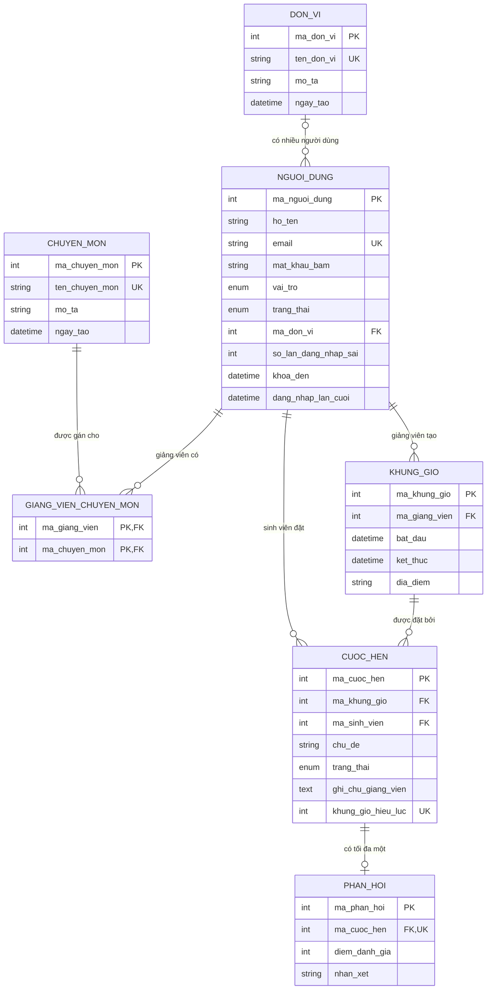

# Cơ sở dữ liệu ConsultBook

CSDL `dat_lich_tu_van` (MySQL/MariaDB, utf8mb4) gồm 7 bảng, chia làm hai nhóm:

- **Nhóm Auth + Admin** (module đã làm): `don_vi`, `chuyen_mon`, `nguoi_dung`, `giang_vien_chuyen_mon`.
- **Nhóm đặt lịch** (khung cho các module khác, cần thống nhất với ERD của nhóm): `khung_gio`, `cuoc_hen`, `phan_hoi`.

## Sơ đồ ERD



## Quy ước đặt tên

- Tên bảng và cột dùng tiếng Việt **không dấu**, viết thường, nối bằng `_` (ví dụ `nguoi_dung`, `mat_khau_bam`). Không dùng tiếng Việt có dấu vì MySQL phải bọc dấu nháy ngược ở mọi câu lệnh và nhiều công cụ xử lý lỗi.
- Khóa chính của bảng X là `ma_x`; khóa ngoại trỏ tới X cũng tên `ma_x` (ví dụ `nguoi_dung.ma_don_vi` trỏ tới `don_vi.ma_don_vi`). Hai ngoại lệ có ý nghĩa vai trò: `ma_giang_vien` và `ma_sinh_vien` đều trỏ tới `nguoi_dung.ma_nguoi_dung`.
- Giá trị của các cột ENUM cũng bằng tiếng Việt không dấu (`sinh_vien`, `giang_vien`, `quan_tri`, `hoat_dong`, `cho_duyet`, `da_khoa`, `da_duyet`, `tu_choi`, `da_huy`, `hoan_thanh`). Giao diện hiển thị nhãn có dấu qua hàm `role_label()` và `status_label()` trong `app/hamtro.php`.

## Từ điển dữ liệu

### `don_vi` – đơn vị công tác (khoa, phòng ban)
| Cột | Kiểu | Ràng buộc | Ý nghĩa |
|---|---|---|---|
| ma_don_vi | INT UNSIGNED | PK, tự tăng | Mã đơn vị |
| ten_don_vi | VARCHAR(100) | NOT NULL, UNIQUE | Tên đơn vị, không trùng |
| mo_ta | VARCHAR(255) | NULL | Mô tả ngắn |
| ngay_tao | DATETIME | mặc định giờ hiện tại | Thời điểm tạo |

### `chuyen_mon` – lĩnh vực tư vấn
Cùng cấu trúc với `don_vi`: `ma_chuyen_mon` (PK), `ten_chuyen_mon` (UNIQUE), `mo_ta`, `ngay_tao`.

### `nguoi_dung` – tài khoản của cả ba vai trò
| Cột | Kiểu | Ràng buộc | Ý nghĩa |
|---|---|---|---|
| ma_nguoi_dung | INT UNSIGNED | PK, tự tăng | Mã người dùng |
| ho_ten | VARCHAR(100) | NOT NULL | Họ và tên |
| email | VARCHAR(190) | NOT NULL, UNIQUE | Tên đăng nhập; không phân biệt hoa thường nhờ collation `utf8mb4_unicode_ci` |
| mat_khau_bam | VARCHAR(255) | NOT NULL | Chuỗi băm bcrypt từ `password_hash()`; không bao giờ lưu mật khẩu gốc |
| vai_tro | ENUM | NOT NULL, mặc định `sinh_vien` | `sinh_vien` / `giang_vien` / `quan_tri` |
| trang_thai | ENUM | NOT NULL, mặc định `hoat_dong` | `hoat_dong` đang dùng, `cho_duyet` giảng viên chờ duyệt, `da_khoa` bị admin khóa |
| ma_don_vi | INT UNSIGNED | FK → don_vi, NULL | Chỉ giảng viên có đơn vị; sinh viên và admin để trống |
| so_lan_dang_nhap_sai | TINYINT UNSIGNED | mặc định 0 | Bộ đếm sai mật khẩu liên tiếp |
| khoa_den | DATETIME | NULL | Thời điểm hết khóa tạm (sau 5 lần sai); khác với `trang_thai = da_khoa` do admin |
| dang_nhap_lan_cuoi | DATETIME | NULL | Lần đăng nhập thành công gần nhất |
| ngay_tao, ngay_cap_nhat | DATETIME | tự động | Dấu thời gian |

### `giang_vien_chuyen_mon` – bảng nối giảng viên và chuyên môn (nhiều-nhiều)
`ma_giang_vien` (FK → nguoi_dung, xóa người dùng thì xóa theo) và `ma_chuyen_mon` (FK → chuyen_mon, đang được gán thì không xóa được). Khóa chính ghép `(ma_giang_vien, ma_chuyen_mon)` nên một giảng viên không bị gán trùng một chuyên môn.

### `khung_gio` – khung giờ tư vấn do giảng viên mở
`ma_khung_gio` (PK), `ma_giang_vien` (FK → nguoi_dung), `bat_dau`, `ket_thuc` (có CHECK `ket_thuc > bat_dau`), `dia_diem`, `ngay_tao`.

### `cuoc_hen` – yêu cầu đặt lịch của sinh viên
| Cột | Ý nghĩa |
|---|---|
| ma_cuoc_hen | PK |
| ma_khung_gio | FK → khung_gio |
| ma_sinh_vien | FK → nguoi_dung (sinh viên đặt) |
| chu_de | Chủ đề cần tư vấn (dữ liệu người dùng nhập, luôn được mã hóa khi in ra) |
| trang_thai | `cho_duyet` chờ duyệt, `da_duyet` đã duyệt, `tu_choi` bị từ chối, `da_huy` đã hủy, `hoan_thanh` hoàn thành |
| ghi_chu_giang_vien | Ghi chú/kết quả của giảng viên |
| khung_gio_hieu_luc | Cột **tự sinh** (STORED): bằng `ma_khung_gio` khi trạng thái là cho_duyet/da_duyet/hoan_thanh, ngược lại là NULL |

### `phan_hoi` – đánh giá sau buổi hẹn
`ma_phan_hoi` (PK), `ma_cuoc_hen` (FK, UNIQUE nên mỗi cuộc hẹn chỉ có một phản hồi), `diem_danh_gia` (CHECK từ 1 đến 5), `nhan_xet`, `ngay_tao`.

## Các quan hệ và lý do thiết kế

| Quan hệ | Loại | Giải thích |
|---|---|---|
| don_vi – nguoi_dung | 1 – nhiều (tùy chọn) | Một đơn vị có nhiều giảng viên; mỗi người thuộc tối đa một đơn vị |
| nguoi_dung – chuyen_mon | nhiều – nhiều | Một giảng viên tư vấn nhiều chuyên môn; một chuyên môn có nhiều giảng viên, nên cần bảng nối |
| nguoi_dung – khung_gio | 1 – nhiều | Giảng viên tạo nhiều khung giờ |
| khung_gio – cuoc_hen | 1 – nhiều | Một khung giờ có thể có nhiều yêu cầu theo thời gian (bị từ chối hoặc hủy), nhưng tại một thời điểm chỉ một yêu cầu hiệu lực |
| nguoi_dung – cuoc_hen | 1 – nhiều | Sinh viên đặt nhiều cuộc hẹn |
| cuoc_hen – phan_hoi | 1 – 0..1 | Chỉ cuộc hẹn đã hoàn thành mới có phản hồi (kiểm tra ở tầng ứng dụng) |

## Ràng buộc quan trọng

- **`email` UNIQUE:** chặn trùng tài khoản ở tầng CSDL, kể cả khi hai yêu cầu đăng ký đến cùng lúc. Code bắt lỗi trùng (mã SQLSTATE 23000) và báo lại cho người dùng.
- **Khóa ngoại `ON DELETE RESTRICT`:** không xóa được đơn vị, chuyên môn, người dùng đang có dữ liệu liên quan. Admin xóa mục đang dùng sẽ nhận thông báo thay vì làm hỏng dữ liệu.
- **`khung_gio_hieu_luc` + UNIQUE:** thực thi quy tắc "một khung giờ chỉ có tối đa một cuộc hẹn đang hiệu lực" ngay trong CSDL. NULL không bị coi là trùng, nên các cuộc hẹn đã hủy/từ chối không chặn người khác đặt. Ngay cả khi code kiểm tra có lỗi, CSDL vẫn không cho hai người giữ cùng một khung giờ.
- **CHECK:** `ket_thuc > bat_dau`, `diem_danh_gia` từ 1 đến 5 (cần MySQL 8.0.16+ hoặc MariaDB 10.2+ để thực sự được thi hành; bản cũ chỉ đọc mà bỏ qua).
- **Prepared statement:** mọi truy vấn trong `app/models/` dùng PDO prepared statement nên dữ liệu người dùng không bao giờ được nối thẳng vào câu SQL.

## Truy vấn mẫu để minh họa khi bảo vệ

```sql
-- Giảng viên đang hoạt động kèm đơn vị và các chuyên môn
SELECT nd.ho_ten, dv.ten_don_vi, GROUP_CONCAT(cm.ten_chuyen_mon SEPARATOR ', ') AS chuyen_mon
FROM nguoi_dung nd
LEFT JOIN don_vi dv ON dv.ma_don_vi = nd.ma_don_vi
LEFT JOIN giang_vien_chuyen_mon g ON g.ma_giang_vien = nd.ma_nguoi_dung
LEFT JOIN chuyen_mon cm ON cm.ma_chuyen_mon = g.ma_chuyen_mon
WHERE nd.vai_tro = 'giang_vien' AND nd.trang_thai = 'hoat_dong'
GROUP BY nd.ma_nguoi_dung, nd.ho_ten, dv.ten_don_vi;

-- Số tài khoản theo vai trò và trạng thái
SELECT vai_tro, trang_thai, COUNT(*) AS so_luong FROM nguoi_dung GROUP BY vai_tro, trang_thai;
```
